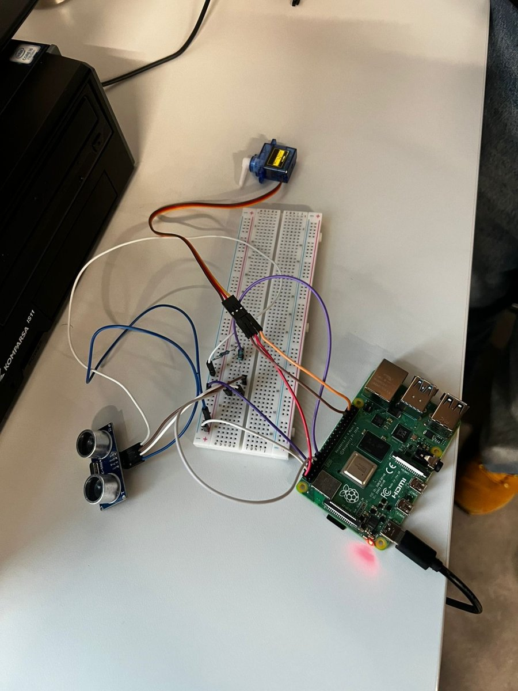
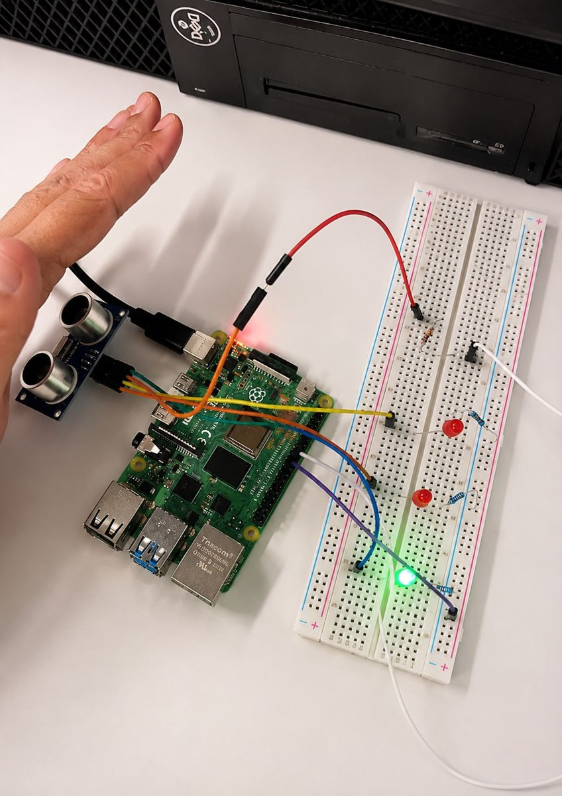
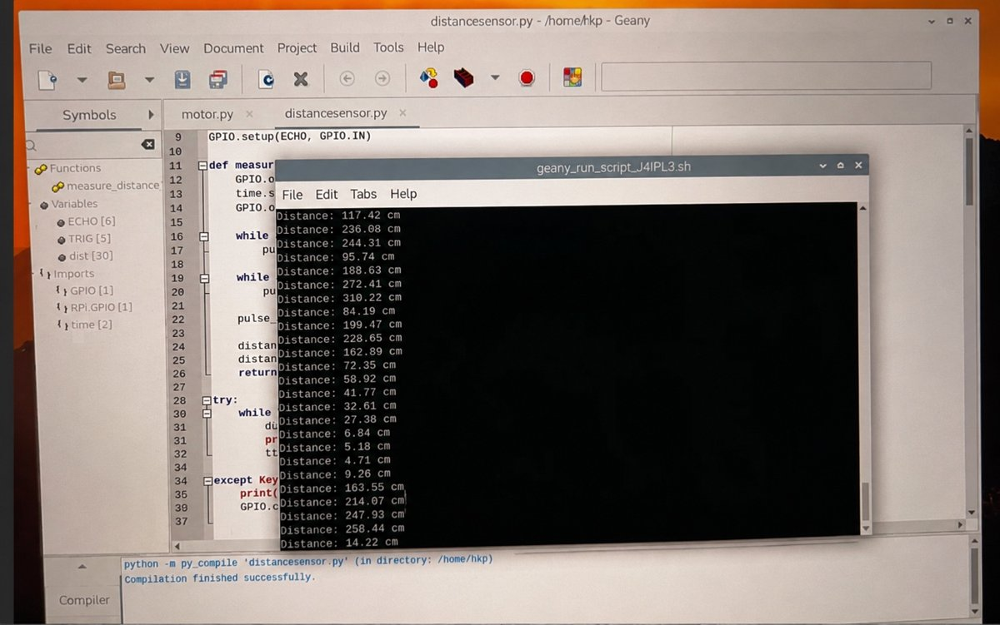

# Lab 3: Distance Measurement with an HC-SR04 Ultrasonic Sensor

An HC-SR04 ultrasonic sensor connected to a Raspberry Pi 4 to measure the distance to nearby objects, programmed in Python with the `RPi.GPIO` library. Part of the course *Systems and Devices of Applied Artificial Intelligence* at VILNIUS TECH.

## What it does
Once per second the program prints the distance to the nearest object in centimetres. In testing, it measured from a few centimetres to more than 2 metres, and the readings changed as a hand was moved in front of the sensor. Pressing `Ctrl + C` stops the program and resets the GPIO pins.

## How it works
The HC-SR04 measures distance using time of flight:

1. The Raspberry Pi sends a 10 microsecond pulse to the **TRIG** pin.
2. The sensor emits an ultrasonic burst and raises the **ECHO** pin until the reflected sound returns.
3. The program times how long ECHO stays HIGH.
4. The sound travelled to the object and back, so:

```
distance (cm) = pulse duration (s) x 34300 / 2 = pulse duration x 17150
```

## Hardware
- Raspberry Pi 4 Model B
- HC-SR04 ultrasonic sensor
- Breadboard and jumper wires

A servo motor was also mounted on the breadboard for possible scanning, but this script only measures distance.

## Wiring
| HC-SR04 pin | Raspberry Pi  |
|-------------|---------------|
| VCC         | 5V            |
| GND         | GND           |
| TRIG        | GPIO 23 (BCM) |
| ECHO        | GPIO 24 (BCM) |

Note: the ECHO pin outputs 5 V, while Raspberry Pi GPIO pins work at 3.3 V, so a voltage divider on the ECHO line is recommended.

## Run
```bash
python3 distancesensor.py
```

## Example output
```
Distance: 117.42 cm
Distance: 95.74 cm
Distance: 41.77 cm
Distance: 5.18 cm
```

## What I learned
- Reading a sensor with GPIO input and output pins
- Measuring pulse width with `time.time()`
- Converting time of flight into distance with the speed of sound
- How readings vary with the object and the environment

## Possible improvements
- Add timeouts to the echo loops so the program cannot hang if no echo returns
- Average several readings to smooth out noise

## Photos



