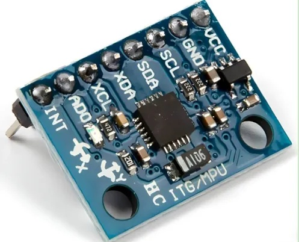
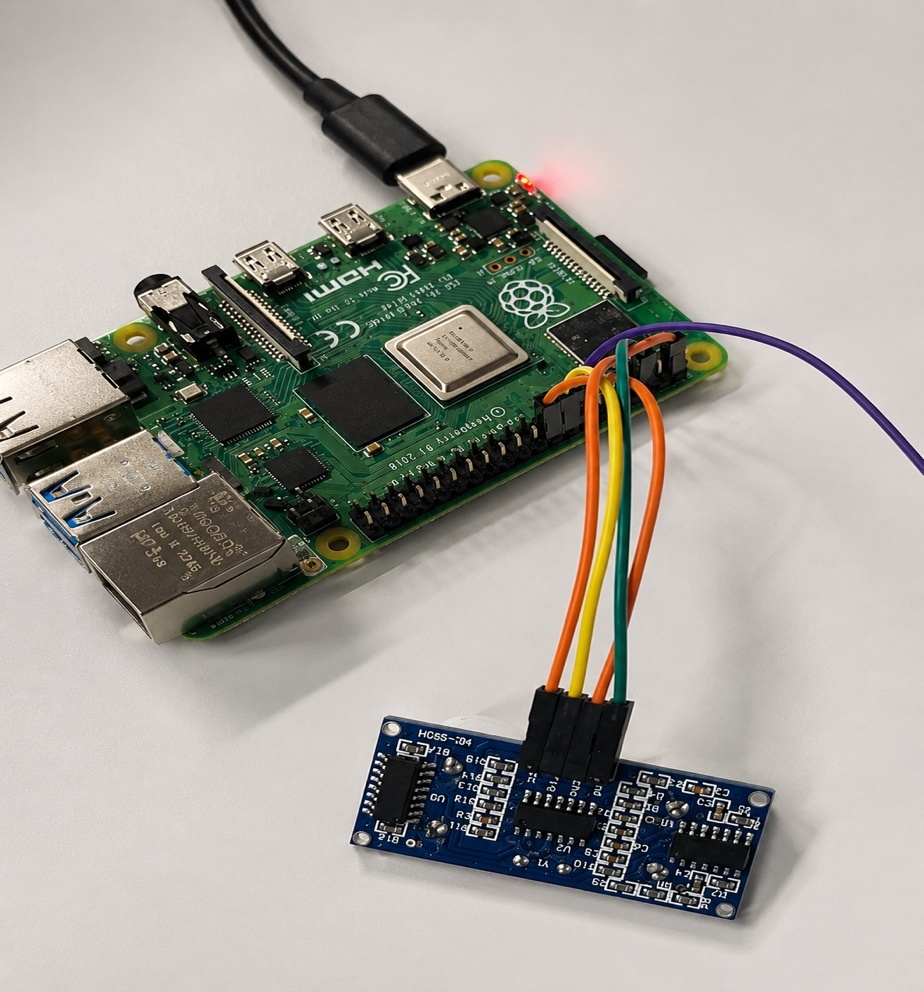
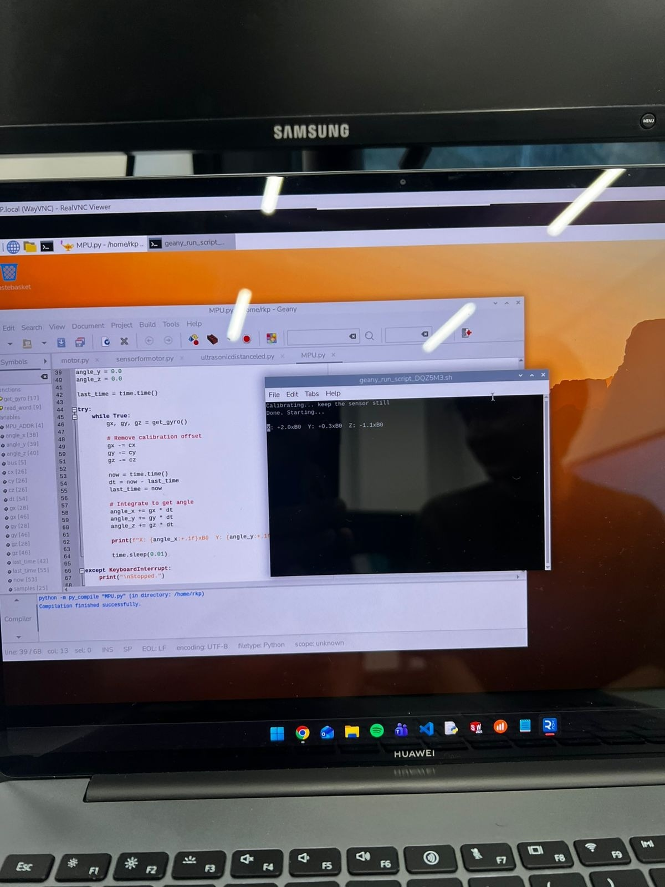

# 03 - Accelerometer (MPU6050)

## Introduction

This experiment demonstrates the interfacing of an MPU6050 accelerometer and gyroscope with a Raspberry Pi using I2C communication.

The MPU6050 is a 6-axis motion tracking sensor that combines a 3-axis accelerometer and a 3-axis gyroscope in a single module. It measures acceleration, tilt, rotation, and angular movement along the X, Y, and Z axes.

The Raspberry Pi communicates with the MPU6050 through the I2C protocol. Python is used to read sensor data, perform gyroscope calibration, and calculate orientation angles in real time.

## Objectives

- Interface the MPU6050 sensor with Raspberry Pi.
- Understand I2C communication.
- Measure acceleration along X, Y, and Z axes.
- Read gyroscope values along three axes.
- Calculate roll and pitch angles.
- Understand real-time motion and orientation sensing.

## Hardware Components

- Raspberry Pi
- MPU6050 Accelerometer and Gyroscope Module
- Jumper wires
- USB power supply

## Hardware Connections

| MPU6050 Pin | Raspberry Pi Pin |
|---|---|
| VCC | 3.3V (Pin 1) |
| GND | Ground (Pin 6) |
| SDA | GPIO 2 / SDA (Pin 3) |
| SCL | GPIO 3 / SCL (Pin 5) |

## Software Requirements

- Raspberry Pi OS
- Python 3
- I2C communication enabled
- smbus2 Python library

## Project Structure

```text
03_accelerometer/
├── README.md
├── MPU.py
├── requirements.txt
├── .gitignore
├── accelerometer_setup_1.jpg
├── accelerometer_setup_2.jpg
└── accelerometer_output.jpg
```

## Software Installation

### Enable I2C

Open the Raspberry Pi configuration tool:

```bash
sudo raspi-config
```

Navigate to:

```text
Interface Options → I2C → Enable
```

Restart the Raspberry Pi if required.

### Install Dependencies

```bash
sudo apt update
sudo apt install -y i2c-tools python3-venv
```

Create a virtual environment:

```bash
python3 -m venv --system-site-packages .venv
source .venv/bin/activate
```

Install the required Python library:

```bash
pip install -r requirements.txt
```

## Check Sensor Connection

Run the following command:

```bash
i2cdetect -y 1
```

The MPU6050 should normally appear at address `0x68`.

## Procedure

### Hardware Setup

The MPU6050 sensor was connected to the Raspberry Pi using jumper wires. The sensor was interfaced through the I2C communication pins SDA and SCL, along with VCC and GND connections.

### Software Setup

A Python program named `MPU.py` was created to initialize and communicate with the MPU6050 sensor.

The program reads acceleration and gyroscope values, performs gyroscope calibration, and calculates tilt angles using a complementary filter.

### Execution

Run the Python program:

```bash
python MPU.py
```

The system continuously displays:

- Acceleration values along X, Y, and Z axes.
- Angular velocity along X, Y, and Z axes.
- Roll angle.
- Pitch angle.

## Working Principle

The MPU6050 measures motion using two integrated sensors.

### Accelerometer

The accelerometer measures linear acceleration along three axes: X, Y, and Z.

### Gyroscope

The gyroscope measures angular velocity along three axes: X, Y, and Z.

### Complementary Filter

The complementary filter combines accelerometer-based tilt measurements with gyroscope measurements to calculate more stable orientation angles.

## Experimental Results

The system reads real-time acceleration and gyroscope data from the MPU6050 sensor.

When the sensor module is moved or tilted, the measured acceleration values and calculated orientation angles change accordingly.

### Hardware Setup





### Sensor Output



## Conclusion

In conclusion, the MPU6050 was successfully interfaced with the Raspberry Pi using I2C communication.

The system was able to provide real-time acceleration and gyroscope measurements and calculate orientation angles based on the movement of the sensor module.

This experiment demonstrated an effective method for integrating motion sensors into embedded systems and robotics applications. It also provided practical knowledge of sensor interfacing, motion tracking, and real-time data processing using Python programming.

Future improvements may include noise reduction techniques and integration with additional sensors for advanced applications such as gesture control and self-balancing systems.
