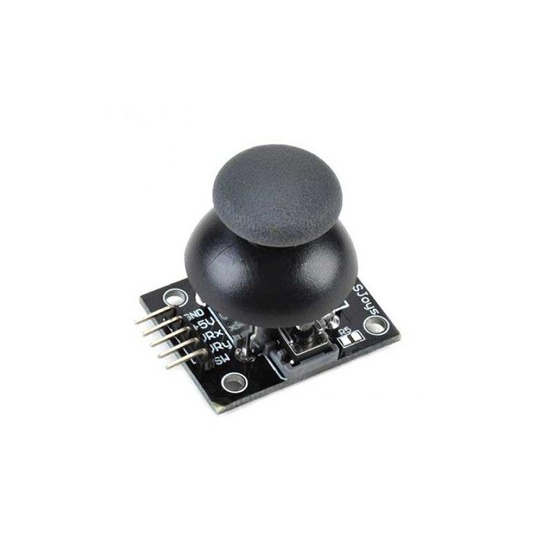
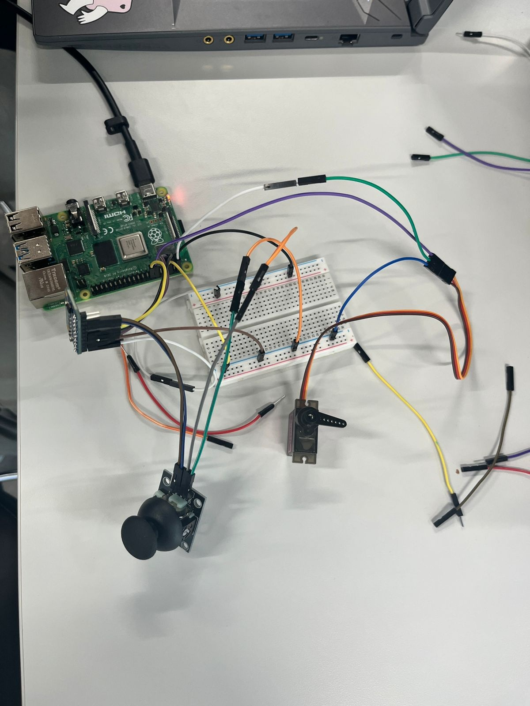
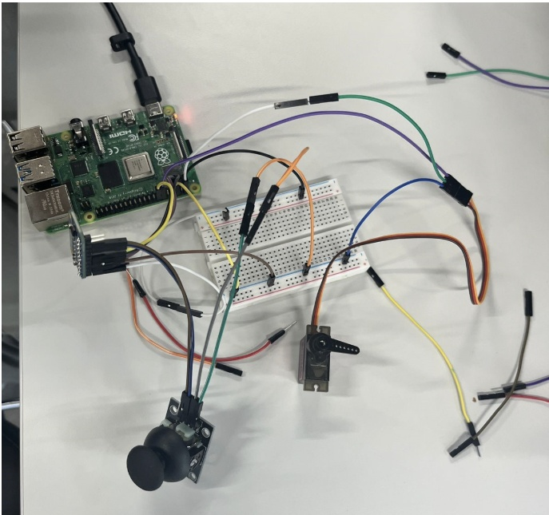

# 04 - Joystick Servo Control

## Introduction

This experiment demonstrates the interfacing of a joystick module with a Raspberry Pi to control a servo motor using analog input and PWM signals.

The joystick module contains two potentiometers that measure movement along the X-axis and Y-axis, along with a push-button switch. The analog signals generated by the joystick are read using an ADS1115 Analog-to-Digital Converter (ADC), since the Raspberry Pi does not have built-in analog input pins.

The Raspberry Pi processes the joystick X-axis voltage using Python programming and converts the input into a servo motor angle. The servo motor is controlled using a PWM signal generated through GPIO 18.

This experiment demonstrates analog signal acquisition, ADC interfacing, GPIO programming, PWM control, and real-time motor positioning.

## Objectives

- Interface a joystick module with Raspberry Pi.
- Understand analog-to-digital conversion using ADS1115.
- Read joystick X-axis movement.
- Control a servo motor using PWM signals.
- Map joystick position to servo angles.
- Implement real-time motor control.

## Hardware Components

- Raspberry Pi
- Joystick Module
- ADS1115 Analog-to-Digital Converter
- Servo Motor
- Jumper wires
- Breadboard
- External 5V servo power supply

## Hardware Connections

### ADS1115 to Raspberry Pi

| ADS1115 Pin | Raspberry Pi Pin |
|---|---|
| VDD | 3.3V (Pin 1) |
| GND | Ground (Pin 6) |
| SDA | GPIO 2 / SDA (Pin 3) |
| SCL | GPIO 3 / SCL (Pin 5) |

### Joystick to ADS1115

| Joystick Pin | Connection |
|---|---|
| VCC | 3.3V |
| GND | GND |
| VRx | ADS1115 A0 |
| VRy | ADS1115 A1 (optional) |
| SW | Not used in this experiment |

### Servo Motor to Raspberry Pi

| Servo Wire | Connection |
|---|---|
| Signal | GPIO 18 (Pin 12) |
| Power | External 5V supply |
| GND | Common ground |

**Important:** The external servo power supply ground must be connected to the Raspberry Pi ground. Do not power the servo directly from the Raspberry Pi 3.3V pin.

## Software Requirements

- Raspberry Pi OS
- Python 3
- I2C enabled
- RPi.GPIO
- Adafruit Blinka
- Adafruit ADS1x15 library

## Project Structure

```text
04_joystick/
├── README.md
├── joystick_servo.py
├── requirements.txt
├── .gitignore
├── joystick_module.jpg
├── joystick_setup.jpg
└── joystick_output.jpg
```

## Software Installation

### Enable I2C

Open the Raspberry Pi configuration tool:

```bash
sudo raspi-config
```

Navigate to:

```text
Interface Options → I2C → Enable
```

Restart the Raspberry Pi if required.

### Install System Dependencies

```bash
sudo apt update
sudo apt install -y i2c-tools python3-venv python3-rpi.gpio
```

### Create Virtual Environment

```bash
python3 -m venv --system-site-packages .venv
source .venv/bin/activate
```

### Install Python Libraries

```bash
pip install -r requirements.txt
```

## Check ADC Connection

Run:

```bash
i2cdetect -y 1
```

The ADS1115 should normally appear at address `0x48`.

## Procedure

### Hardware Setup

The joystick module was connected to the Raspberry Pi through the ADS1115 ADC. The ADC communicates with the Raspberry Pi using I2C.

The joystick X-axis analog output was connected to channel A0 of the ADS1115. The servo motor signal wire was connected to GPIO 18, which was configured as a PWM output.

### Software Setup

A Python program named `joystick_servo.py` was created to read joystick voltage values through the ADS1115 ADC.

The program calibrates the joystick center position, applies a deadzone to avoid unwanted movements, converts the joystick voltage into a servo angle, and generates PWM signals to control the servo motor.

### Execution

Run the program:

```bash
python joystick_servo.py
```

Move the joystick toward the left and right directions to control the servo motor.

Press `Ctrl+C` to stop the program.

## Working Principle

### Joystick Input

The joystick uses potentiometers to generate analog voltage signals corresponding to movement along the X and Y axes.

### Analog-to-Digital Conversion

The ADS1115 converts the analog joystick voltage into digital values that can be processed by the Raspberry Pi.

### PWM Servo Control

The Raspberry Pi generates a PWM signal through GPIO 18. The PWM duty cycle is adjusted according to the joystick position to control the servo motor angle.

### Joystick-to-Servo Mapping

- Joystick toward the left: Servo moves toward 0°.
- Joystick at the center: Servo moves toward 90°.
- Joystick toward the right: Servo moves toward 180°.

A deadzone around the center position prevents small fluctuations from causing unwanted servo movements.

## Experimental Results

The joystick module was interfaced with the Raspberry Pi using the ADS1115 ADC. The joystick input was processed to control the servo motor position.

When the joystick was moved, the servo motor responded according to the joystick movement.

### Joystick Module



### Hardware Setup



### Experimental Output



## Conclusion

In conclusion, the joystick module was successfully interfaced with the Raspberry Pi using an ADS1115 Analog-to-Digital Converter. The joystick X-axis input was processed using Python programming, and PWM signals were generated through GPIO 18 to control the servo motor.

The servo motor responded to joystick movement by changing its angle between 0° and 180°. The experiment demonstrated practical knowledge of analog input acquisition, ADC interfacing, PWM control, and real-time motor control, which are important concepts in robotics and embedded systems applications.
